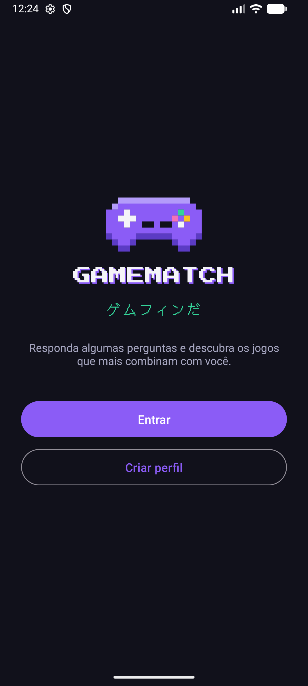
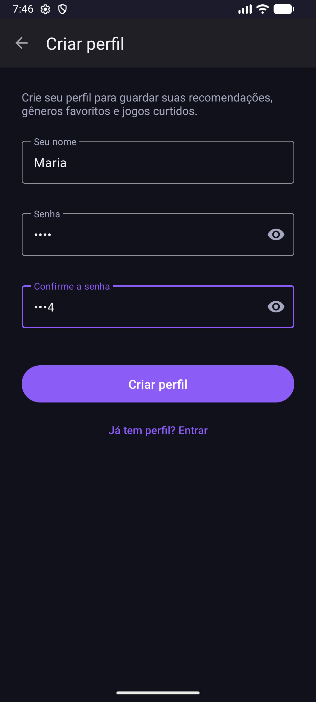
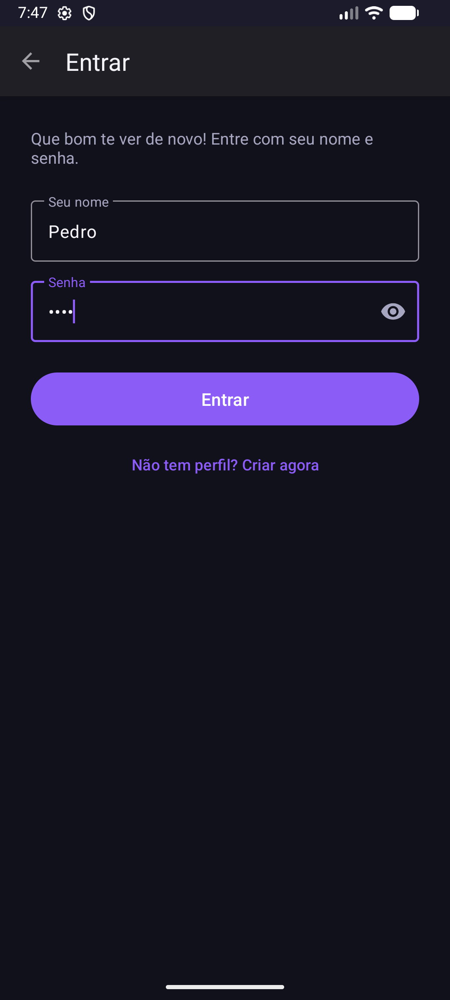
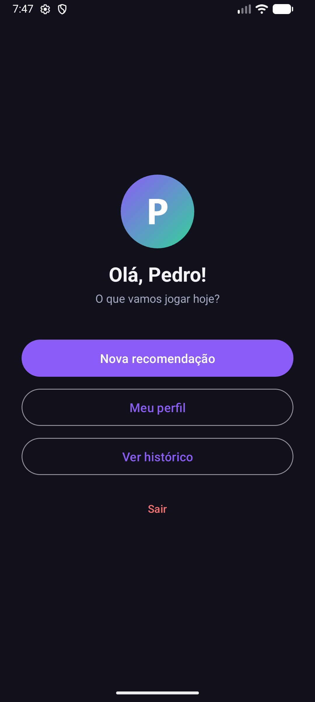
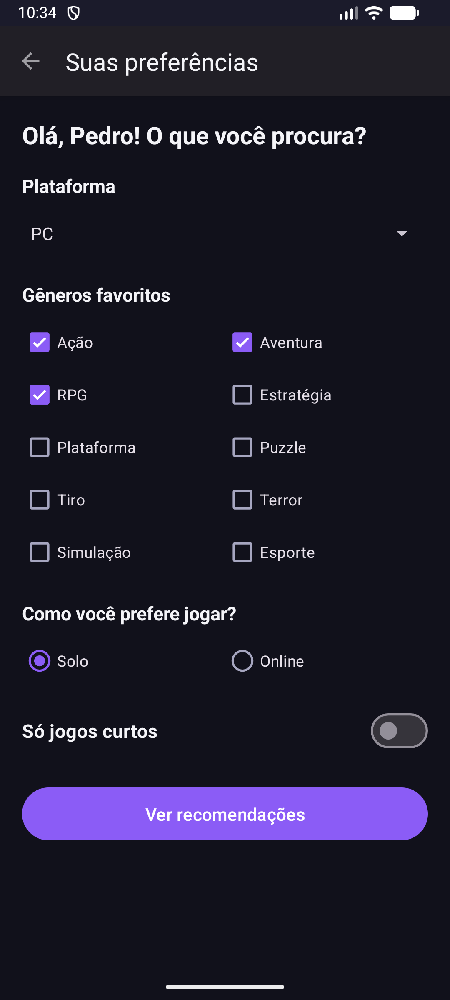
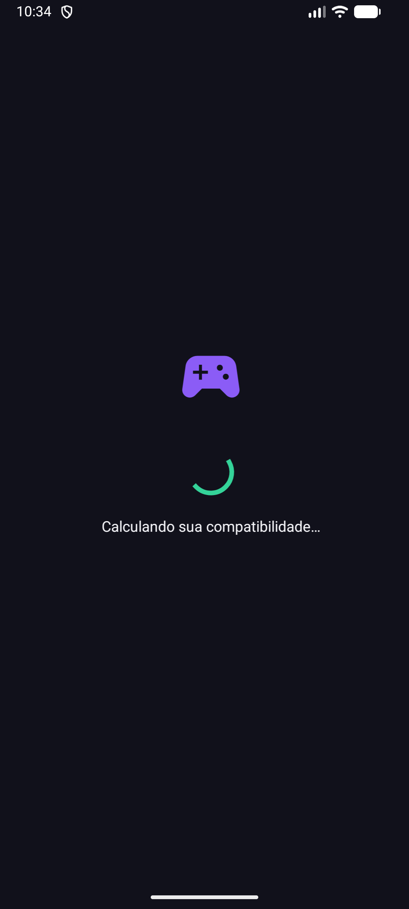
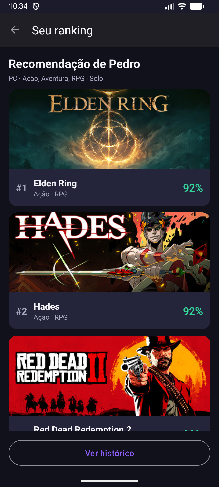

# GameMatch

Recomendador de jogos — projeto da AP2 de Desenvolvimento Mobile.

## Descrição

A pessoa cria um perfil (nome e senha) ou entra em um existente. Depois responde algumas preferências (plataforma, gêneros, solo ou online, só jogos curtos), e o app envia as respostas para uma API REST, que calcula a compatibilidade de cada jogo de um catálogo de 34 títulos salvo no banco e devolve um ranking personalizado com os 10 melhores.

Cada recomendação fica salva no histórico do usuário, onde pode ser reaberta, renomeada, favoritada ou apagada. O perfil guarda uma foto, os gêneros favoritos (que já vêm marcados nas preferências) e os jogos curtidos na tela de detalhes.

O projeto tem duas partes:

- `backend/` — API REST em Spring Boot (Kotlin) com banco H2 em arquivo.
- `android/` — app Android nativo em Kotlin com XML Views.

## Tecnologias

**Backend**

- Kotlin + Spring Boot 4 (Spring Web MVC)
- Spring Data JPA + H2 em arquivo (os dados persistem entre execuções)
- BCrypt (`spring-security-crypto`) para guardar o hash das senhas
- springdoc-openapi (Swagger UI)
- Gradle (wrapper incluído)

**Android**

- Kotlin, XML Views e Activities (sem Compose), ViewBinding
- Retrofit + Gson para consumir a API
- Coroutines (`lifecycleScope`) para as chamadas assíncronas
- Material Components, RecyclerView e CardView
- Coil para carregar as capas dos jogos e a foto de perfil
- SharedPreferences para manter a sessão (quem está logado)

## Como executar

Pré-requisitos: Android Studio (com um emulador configurado) e um JDK 21 ou mais novo. Se não houver JDK instalado, dá para usar o que vem com o Android Studio.

### 1. Backend

```bash
cd backend
./gradlew bootRun
```

No Windows (PowerShell), usando o JDK embutido do Android Studio:

```powershell
cd backend
$env:JAVA_HOME = "C:\Program Files\Android\Android Studio\jbr"
.\gradlew.bat bootRun
```

A API sobe em `http://localhost:8080`. Na primeira execução o catálogo de jogos é inserido automaticamente; o banco fica em `backend/data/`.

### 2. App Android

1. Abra a pasta `android/` no Android Studio e aguarde o Gradle sincronizar.
2. Com o backend rodando, execute o app em um **emulador**.
3. Toque em **Criar perfil** para criar um usuário (a senha precisa ter pelo menos 4 caracteres).

O app acessa a API em `http://10.0.2.2:8080/`, endereço que só funciona no emulador (é o `localhost` do computador visto de dentro dele). O emulador também precisa de internet para baixar as capas dos jogos.

## Screenshots

| Boas-vindas | Criar perfil | Entrar |
|:-:|:-:|:-:|
|  |  |  |

| Início | Preferências | Carregando |
|:-:|:-:|:-:|
|  |  |  |

| Resultado | Detalhes do jogo | Histórico |
|:-:|:-:|:-:|
|  |  |  |

| Perfil | Estado de erro (API fora do ar) |
|:-:|:-:|
|  |  |

## Telas

| # | Tela | O que faz |
|---|------|-----------|
| 1 | Boas-vindas | Botões **Entrar** e **Criar perfil**. Quem já está logado vai direto para o Início. |
| 2 | Entrar / Criar perfil | Nome e senha (e confirmação, no cadastro), com validação nos campos. Chama `POST /auth/login` ou `POST /auth/register`. |
| 3 | Início | Foto e saudação do usuário, atalhos para nova recomendação, perfil e histórico, e **Sair**. |
| 4 | Preferências | Plataforma (Spinner), gêneros (CheckBox, já marcando os favoritos do perfil), solo/online (RadioButton) e "só jogos curtos" (Switch). |
| 5 | Carregando | ProgressBar enquanto faz o `POST /recommendations`; em caso de erro, permite tentar de novo. |
| 6 | Resultado | RecyclerView de CardViews com capa, nome e % de compatibilidade. |
| 7 | Detalhes do jogo | Dados do jogo, botão de curtir e Intents implícitas: abrir a loja (`ACTION_VIEW`) e compartilhar (`ACTION_SEND`). |
| 8 | Histórico | Recomendações do usuário logado, com favoritar e renomear (`PUT`) e apagar (`DELETE`). |
| 9 | Perfil | Foto (escolhida no seletor de fotos do sistema e enviada à API), gêneros favoritos (Chips) e jogos curtidos. |

A navegação entre as telas usa Intents explícitas. Ao entrar ou sair, as telas anteriores são removidas da pilha, então o botão "voltar" não retorna à sessão anterior.

Views utilizadas: TextView, EditText (TextInputLayout), Button, ImageButton, ImageView, ShapeableImageView, Spinner, CheckBox, RadioButton, Switch, Chip, ProgressBar, RecyclerView e CardView.

### Organização do código Android

```
com.gamematch.app
├── data
│   ├── api          Retrofit (GameMatchApi, ApiClient e o helper apiCall)
│   ├── model        Classes de dados trocadas com a API
│   └── UserSession  Usuário logado, salvo em SharedPreferences
├── adapter      Adapters dos RecyclerViews
└── ui
    ├── common       Código compartilhado (BaseActivity, ScreenState, extensões)
    ├── welcome      Tela 1
    ├── auth         Tela 2
    ├── home         Tela 3
    ├── preferences  Tela 4
    ├── loading      Tela 5
    ├── result       Tela 6
    ├── detail       Tela 7
    ├── history      Tela 8
    └── profile      Tela 9
```

## API

Documentação interativa (Swagger), com o backend rodando: **http://localhost:8080/swagger-ui.html**

Todas as requisições e respostas usam JSON (exceto o envio da foto, que é `multipart/form-data`).

| Método | Rota | Descrição |
|--------|------|-----------|
| POST | `/auth/register` | Cria um perfil com nome e senha (`409` se o nome já existir). |
| POST | `/auth/login` | Confere nome e senha e devolve o perfil (`401` se estiverem errados). |
| GET | `/games` | Lista o catálogo de jogos. |
| GET | `/games/{id}` | Busca um jogo. |
| POST | `/recommendations` | Recebe as preferências, calcula o ranking, salva e devolve o resultado. |
| GET | `/recommendations` | Lista o histórico (mais recentes primeiro). Aceita `?userName=` para filtrar por usuário. |
| GET | `/recommendations/{id}` | Busca uma recomendação. |
| PUT | `/recommendations/{id}` | Renomeia e/ou favorita uma recomendação. |
| DELETE | `/recommendations/{id}` | Apaga uma recomendação. |
| GET | `/profiles/{userName}` | Busca o perfil. |
| PUT | `/profiles/{userName}` | Salva os gêneros favoritos. |
| POST | `/profiles/{userName}/photo` | Envia a foto de perfil (campo `photo`). |
| GET | `/profiles/{userName}/photo` | Devolve a imagem da foto. |
| PUT | `/profiles/{userName}/likes/{gameId}` | Curte um jogo. |
| DELETE | `/profiles/{userName}/likes/{gameId}` | Remove a curtida. |

Exemplo de cadastro (`POST /auth/register`) ou login (`POST /auth/login`):

```json
{ "userName": "Pedro", "password": "1234" }
```

Resposta (o perfil; a senha nunca é devolvida):

```json
{ "userName": "Pedro", "favoriteGenres": ["Aventura", "RPG"], "likedGames": [], "photoVersion": 1 }
```

Exemplo de `POST /recommendations`:

```json
{
  "userName": "Pedro",
  "platform": "PC",
  "genres": ["RPG", "Ação"],
  "mode": "SOLO",
  "shortOnly": false
}
```

Resposta (resumida):

```json
{
  "id": 1,
  "userName": "Pedro",
  "title": "Recomendação de Pedro",
  "favorite": false,
  "createdAt": "2026-11-15T19:15:18",
  "platform": "PC",
  "genres": ["RPG", "Ação"],
  "mode": "SOLO",
  "shortOnly": false,
  "results": [
    { "game": { "id": 1145360, "name": "Hades", "genres": ["Ação", "RPG"] }, "score": 100 }
  ]
}
```

Exemplo de `PUT /recommendations/1` (envie só os campos que quiser alterar):

```json
{ "title": "Jogos para as férias", "favorite": true }
```

Erros voltam com o status adequado (`400` dados inválidos, `401` login incorreto, `404` não encontrado, `409` nome já usado) e um campo `message` explicando o problema, que o app mostra ao usuário.

**Simplificação:** depois do login, o app identifica o usuário pelo nome guardado na sessão; as rotas de perfil e recomendações não exigem token. Em um sistema real, o login devolveria um token (por exemplo, JWT) que seria enviado em cada requisição.

### Cálculo da compatibilidade

Cada jogo recebe uma nota de 0 a 100, somando quatro critérios:

| Critério | Peso | Regra |
|----------|------|-------|
| Gêneros | 50 | Média entre a fração dos gêneros pedidos que o jogo tem e a fração dos gêneros do jogo que foram pedidos. |
| Plataforma | 25 | O jogo está disponível na plataforma escolhida. |
| Modo | 15 | O modo do jogo (solo/online) combina com o escolhido. |
| Duração | 10 | Com "só jogos curtos" ligado, só jogos curtos pontuam; desligado, todos pontuam. |

## Créditos

- Fontes da logo: [Press Start 2P](https://fonts.google.com/specimen/Press+Start+2P) e [DotGothic16](https://fonts.google.com/specimen/DotGothic16), ambas sob a SIL Open Font License (cópias em `docs/licenses/`).
- Capas dos jogos e links das lojas: Steam.
