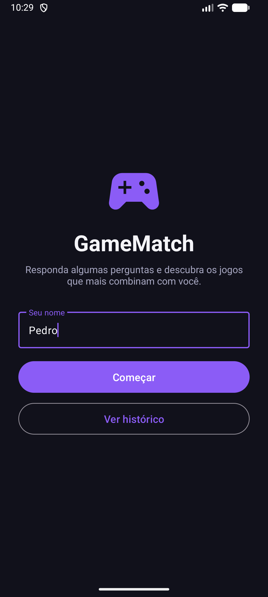
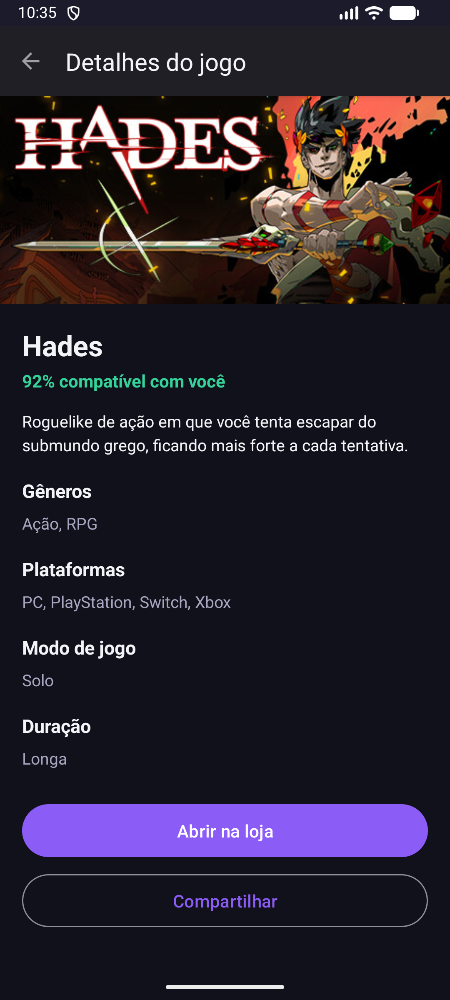
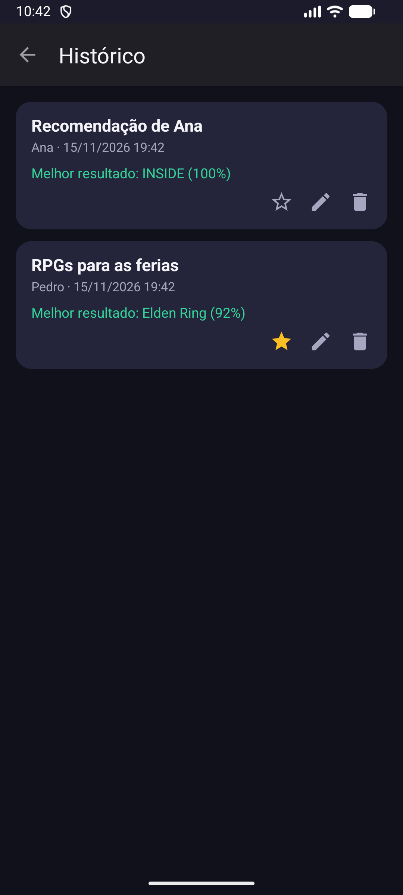
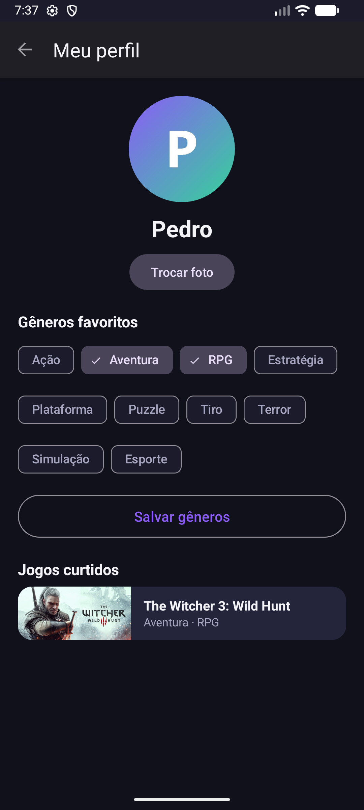
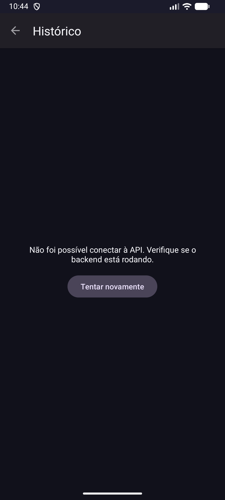

# GameMatch

Recomendador de jogos — projeto da AP2 de Desenvolvimento Mobile.

## Descrição

O usuário informa o nome e responde algumas preferências (plataforma, gêneros favoritos, solo ou online, só jogos curtos). O app envia as respostas para uma API REST, que calcula a compatibilidade de cada jogo de um catálogo de 34 títulos salvo no banco e devolve um ranking personalizado com os 10 melhores. Cada recomendação fica salva em um histórico, onde pode ser reaberta, renomeada, favoritada ou apagada.

Cada usuário também tem um perfil com foto, gêneros favoritos (que já vêm marcados na tela de preferências) e os jogos que curtiu na tela de detalhes.

O projeto tem duas partes:

- `backend/` — API REST em Spring Boot (Kotlin) com banco H2 em arquivo.
- `android/` — app Android nativo em Kotlin com XML Views.

## Tecnologias

**Backend**

- Kotlin + Spring Boot 4 (Spring Web MVC)
- Spring Data JPA + H2 em arquivo (os dados persistem entre execuções)
- springdoc-openapi (Swagger UI)
- Gradle (wrapper incluído)

**Android**

- Kotlin, XML Views e Activities (sem Compose), ViewBinding
- Retrofit + Gson para consumir a API
- Coroutines (`lifecycleScope`) para as chamadas assíncronas
- Material Components, RecyclerView e CardView
- Coil para carregar as capas dos jogos

## Como executar

Pré-requisitos: Android Studio (com um emulador configurado) e um JDK 21 ou mais novo. Se não houver JDK instalado, dá para usar o que vem com o Android Studio.

### 1. Backend

```bash
cd backend
./gradlew bootRun
```

No Windows (PowerShell), usando o JDK embutido do Android Studio:

```powershell
cd backend
$env:JAVA_HOME = "C:\Program Files\Android\Android Studio\jbr"
.\gradlew.bat bootRun
```

A API sobe em `http://localhost:8080`. Na primeira execução o catálogo de jogos é inserido automaticamente; o banco fica em `backend/data/`.

### 2. App Android

1. Abra a pasta `android/` no Android Studio e aguarde o Gradle sincronizar.
2. Com o backend rodando, execute o app em um **emulador**.

O app acessa a API em `http://10.0.2.2:8080/`, endereço que só funciona no emulador (é o `localhost` do computador visto de dentro dele). O emulador também precisa de internet para baixar as capas dos jogos.

## Screenshots

| Boas-vindas | Preferências | Carregando |
|:-:|:-:|:-:|
|  |  |  |

| Resultado | Detalhes do jogo | Histórico |
|:-:|:-:|:-:|
|  |  |  |

| Perfil | Estado de erro (API fora do ar) |
|:-:|:-:|
|  |  |

## Telas

| # | Tela | O que faz |
|---|------|-----------|
| 1 | Boas-vindas | Pede o nome do usuário (lembrado entre execuções) e inicia o fluxo, ou abre o perfil ou o histórico. |
| 2 | Preferências | Plataforma (Spinner), gêneros (CheckBox, já marcando os favoritos do perfil), solo/online (RadioButton) e "só jogos curtos" (Switch). |
| 3 | Carregando | ProgressBar enquanto faz o `POST /recommendations`; em caso de erro, permite tentar de novo. |
| 4 | Resultado | RecyclerView de CardViews com capa, nome e % de compatibilidade. |
| 5 | Detalhes do jogo | Dados do jogo, botão de curtir e Intents implícitas: abrir a loja (`ACTION_VIEW`) e compartilhar (`ACTION_SEND`). |
| 6 | Histórico | Lista do `GET /recommendations`, com favoritar e renomear (`PUT`) e apagar (`DELETE`). |
| 7 | Perfil | Foto (escolhida no seletor de fotos do sistema e enviada à API), gêneros favoritos (Chips) e lista de jogos curtidos. |

A navegação entre as telas usa Intents explícitas. Views utilizadas: TextView, EditText, Button, ImageButton, ImageView, ShapeableImageView, Spinner, CheckBox, RadioButton, Switch, Chip, ProgressBar, RecyclerView e CardView.

### Organização do código Android

```
com.gamematch.app
├── data
│   ├── api          Retrofit (GameMatchApi, ApiClient e o helper apiCall)
│   ├── model        Classes de dados trocadas com a API
│   └── UserSession  Nome do usuário atual, salvo em SharedPreferences
├── adapter      Adapters dos RecyclerViews
└── ui
    ├── common       Código compartilhado (BaseActivity, ScreenState, extensões)
    ├── welcome      Tela 1
    ├── preferences  Tela 2
    ├── loading      Tela 3
    ├── result       Tela 4
    ├── detail       Tela 5
    ├── history      Tela 6
    └── profile      Tela 7
```

## API

Documentação interativa (Swagger), com o backend rodando: **http://localhost:8080/swagger-ui.html**

Todas as requisições e respostas usam JSON.

| Método | Rota | Descrição |
|--------|------|-----------|
| GET | `/games` | Lista o catálogo de jogos. |
| GET | `/games/{id}` | Busca um jogo. |
| POST | `/recommendations` | Recebe as preferências, calcula o ranking, salva e devolve o resultado. |
| GET | `/recommendations` | Lista o histórico (mais recentes primeiro). |
| GET | `/recommendations/{id}` | Busca uma recomendação. |
| PUT | `/recommendations/{id}` | Renomeia e/ou favorita uma recomendação. |
| DELETE | `/recommendations/{id}` | Apaga uma recomendação. |
| GET | `/profiles/{userName}` | Busca o perfil (devolve um perfil vazio se ainda não existir). |
| PUT | `/profiles/{userName}` | Salva os gêneros favoritos. |
| POST | `/profiles/{userName}/photo` | Envia a foto de perfil (`multipart/form-data`, campo `photo`). |
| GET | `/profiles/{userName}/photo` | Devolve a imagem da foto. |
| PUT | `/profiles/{userName}/likes/{gameId}` | Curte um jogo. |
| DELETE | `/profiles/{userName}/likes/{gameId}` | Remove a curtida. |

O perfil é identificado pelo nome digitado na tela de boas-vindas (não há login).

Exemplo de `POST /recommendations`:

```json
{
  "userName": "Pedro",
  "platform": "PC",
  "genres": ["RPG", "Ação"],
  "mode": "SOLO",
  "shortOnly": false
}
```

Resposta (resumida):

```json
{
  "id": 1,
  "userName": "Pedro",
  "title": "Recomendação de Pedro",
  "favorite": false,
  "createdAt": "2026-11-15T19:15:18",
  "platform": "PC",
  "genres": ["RPG", "Ação"],
  "mode": "SOLO",
  "shortOnly": false,
  "results": [
    { "game": { "id": 1145360, "name": "Hades", "genres": ["Ação", "RPG"] }, "score": 100 }
  ]
}
```

Exemplo de `PUT /recommendations/1` (envie só os campos que quiser alterar):

```json
{ "title": "Jogos para as férias", "favorite": true }
```

Erros voltam com o status adequado (`400` para dados inválidos, `404` para id inexistente) e um campo `message` explicando o problema.

### Cálculo da compatibilidade

Cada jogo recebe uma nota de 0 a 100, somando quatro critérios:

| Critério | Peso | Regra |
|----------|------|-------|
| Gêneros | 50 | Média entre a fração dos gêneros pedidos que o jogo tem e a fração dos gêneros do jogo que foram pedidos. |
| Plataforma | 25 | O jogo está disponível na plataforma escolhida. |
| Modo | 15 | O modo do jogo (solo/online) combina com o escolhido. |
| Duração | 10 | Com "só jogos curtos" ligado, só jogos curtos pontuam; desligado, todos pontuam. |
